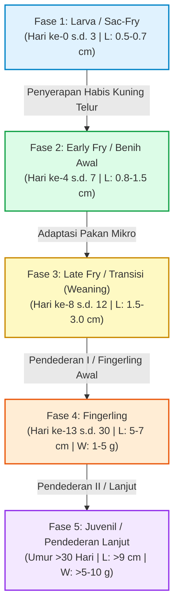
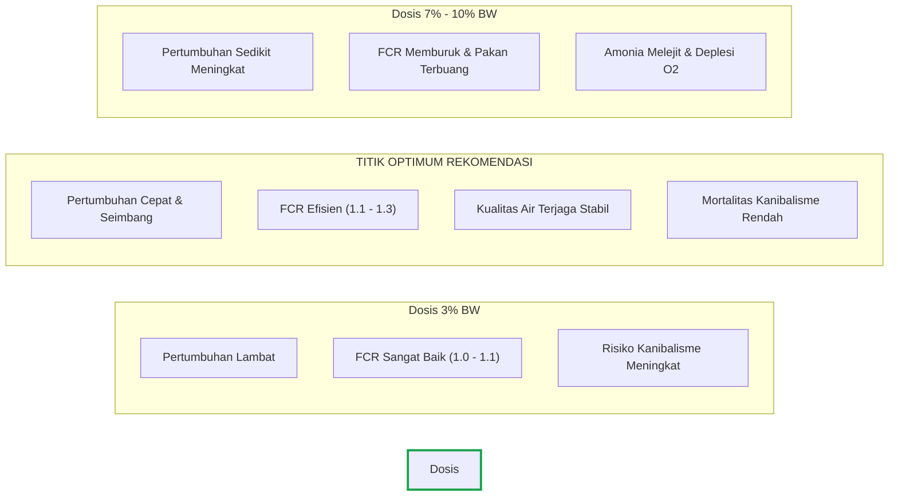
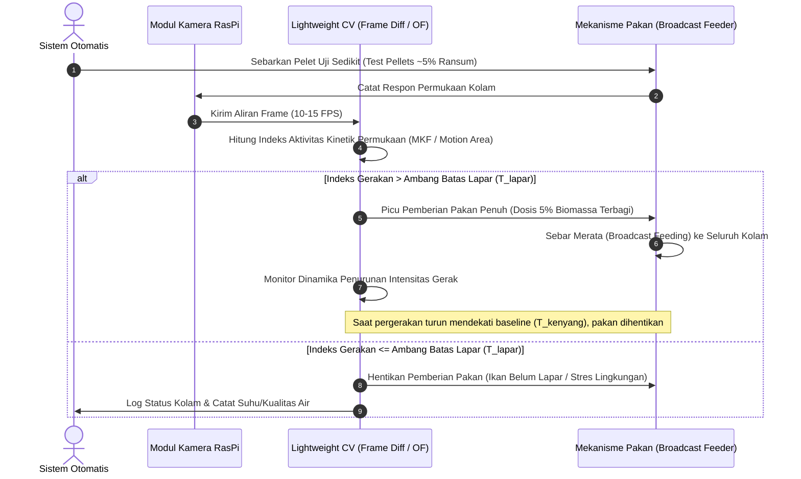

# Standar Karakteristik Bibit Lele, Parameter Lingkungan Budidaya, dan Manajemen Takaran Pakan Presisi Berbasis Literatur Ilmiah Terverifikasi

> **Identitas Dokumen & Peneliti**:
> - **Nama Mahasiswa**: Khoirotun Nisa'
> - **NIM**: 2341720057
> - **Dosen Pembimbing**: Dr. Ulla Delfana Rosiani, ST., MT.
> - **Institusi**: Jurusan Teknologi Informasi, Politeknik Negeri Malang
> - **Topik Skripsi**: *Deteksi Aktivitas Ikan Lele sebagai Indikasi Lapar Berbasis Computer Vision*
> - **Fokus Komoditas**: Bibit Ikan Lele (*Catfish Fry & Fingerlings* — Famili *Clariidae* / Genus *Clarias spp.*)
> - **Tanggal Penyusunan**: 21 September 2026

---

## 1. Pendahuluan & Urgensi Domain Bibit Lele

Pembenihan dan pendederan ikan lele (*Clarias spp.*, khususnya *Clarias gariepinus* / Lele Dumbo dan *Clarias sp.* galur Sangkuriang) merupakan fase paling kritis (*critical bottleneck*) dalam keseluruhan siklus industri akuakultur air tawar (Gisbert et al., 2021; Kurdowi et al., 2025). Pada fase benih (mulai dari larva baru menetas hingga ukuran *fingerling*), tingkat mortalitas benih sering kali melonjak drastis akibat dua faktor utama:
1. **Kerentanan Fisiologis & Keterbatasan Nutrisi**: Organ pencernaan benih yang baru menyerap kantung telur belum memiliki enzimatis lengkap untuk mencerna pelet kasar, sehingga mutlak memerlukan pakan alami berprotein tinggi sebelum beralih ke formulasi buatan (Srivastava et al., 2012; Gisbert et al., 2021).
2. **Sifat Agresif & Kanibalisme Tinggi**: Disparitas ukuran (*size heterogeneity*) dan keterlambatan atau ketidakmerataan pemberian pakan memicu kanibalisme ganas di antara benih sejenis, yang dapat memusnahkan 30–60% populasi dalam hitungan hari jika manajemen pakan tidak terkontrol (Gisbert et al., 2021; Biswas et al., 2023).

Di sisi lain, pemberian pakan berlebih (*overfeeding*) pada kolam benih lele menimbulkan konsekuensi fatal yang sama beratnya. Sisa pakan mikro berprotein tinggi (35–42%) sangat cepat membusuk di dasar kolam, menyebabkan deplesi oksigen terlarut (*Dissolved Oxygen* / DO < 3 mg/L) serta lonjakan amonia bebas ($NH_3$) yang mematikan benih (Afia et al., 2020; Jibrin et al., 2024; Kurdowi et al., 2025).

Oleh sebab itu, penerapan **sistem pemantauan aktivitas makan berbasis visi komputer (*computer vision*)** pada perangkat tepi (*edge device* Raspberry Pi) membutuhkan acuan standar biologis yang presisi. Dokumen ini menyajikan sintesis komprehensif mengenai **tahapan umur bibit lele, standar kualitas air, takaran pakan harian (% biomassa), frekuensi pemberian pakan, serta strategi mitigasi kanibalisme** berdasarkan konsensus literatur ilmiah internasional dan nasional terverifikasi.

---

## 2. Klasifikasi Fase Perkembangan Bibit Lele & Karakteristik Morfologis

Berdasarkan perkembangan ontogenetik, morfologi bukaan mulut (*mouth gape*), dan kesiapan saluran pencernaan, fase hidup awal bibit lele diklasifikasikan ke dalam 5 (lima) tahapan utama (Gisbert et al., 2021; Kurdowi et al., 2025; Weirich et al., 2001; Barriga & Battini, 2009):

### Tabel 1: Matriks Standar Fase Umur, Morfologi, dan Kebutuhan Pakan Bibit Lele

| No | Fase Perkembangan | Rentang Umur | Panjang (cm) & Bobot (g) | Karakteristik Biologis & Bukaan Mulut | Jenis Pakan Utama | Frekuensi Pakan Harian | Rujukan Ilmiah |
|:--:|---|:---:|:---:|---|---|:---:|---|
| **1** | **Larva / Sac-Fry** | Hari ke-0 s.d. ke-3 pascatetas | 0,5 – 0,7 cm (< 0,01 g) | Mengandalkan cadangan kuning telur (*yolk sac*); saluran cerna belum terbuka sempurna; organ pernapasan tambahan belum aktif. | **Nihil** (belum diberi pakan luar). Mengandalkan nutrisi endogen kuning telur. | 0 kali | Kurdowi et al. (2025); Weirich et al. (2001) |
| **2** | **Early Fry** (Benih Awal) | Hari ke-4 s.d. ke-7 pascatetas | 0,8 – 1,5 cm (0,01 – 0,1 g) | Kuning telur terserap habis (*onset of exogenous feeding*); bukaan mulut sempit (*mouth gape constraint*); gerak aktif mencari partikel hidup. | Pakan alami hidup: Cacing sutra (*Tubifex sp.*), nauplii *Artemia*, atau *Daphnia sp.* | *Ad libitum*, 3–5 kali sehari | Sri Mulyani et al. (2024); Pranat et al. (2025); Okomoda et al. (2019) |
| **3** | **Late Fry / Transisi** (*Weaning*) | Hari ke-8 s.d. ke-12 pascatetas | 1,5 – 3,0 cm (0,1 – 0,8 g) | Mulai mampu menelan partikel remah; transisi dari pakan alami hidup ke pakan buatan formulasi (*weaning phase*). | Kombinasi cacing sutra + tepung pelet mikro terhidrasi (misal pakan serbuk PF-500 / PF-1000 dibasahi air hangat). | 3 kali sehari | Kurdowi et al. (2025); Gisbert et al. (2021) |
| **4** | **Fingerling Awal** (Pendederan I) | Hari ke-13 s.d. ke-30 pascatetas | 5,0 – 7,0 cm (1,0 – 5,0 g) | Sirip dan sungut berkembang sempurna; organ arborescent mulai berfungsi; agresivitas tinggi; respons menyambar pakan sangat cepat. | Pelet butiran mikro mengapung (*floating micro-pellet*) kadar protein tinggi (35–42% *Crude Protein*). | 3–4 kali sehari (dosis 5% biomassa) | Essien et al. (2024); Afia et al. (2020); Jibrin et al. (2024); Okomoda et al. (2019) |
| **5** | **Juvenil / Pendederan Lanjut** | Umur > 30 hari pascatetas | 7,0 – 12,0 cm (5,0 – 15,0 g) | Lambung dan enzim proteolitik sempurna; toleransi lingkungan meningkat; laju pertumbuhan relatif melambat dibanding fase larva. | Pelet komersial mengapung diameter 1,0 – 2,0 mm dengan kadar protein 30–35% CP. | 2–3 kali sehari (dosis 2–3% biomassa) | Tippayadara et al. (2016); Ng et al. (2000); Hogendoorn (1981) |

---

## 3. Standar Parameter Kualitas Air Pembenihan Bibit Lele

Benih lele membutuhkan stabilitas parameter lingkungan yang jauh lebih ketat dibandingkan lele dewasa konsumsi. Meskipun ikan lele dewasa terkenal memiliki toleransi tinggi terhadap air keruh dan rendah oksigen berkat organ pernapasan tambahan (*arborescent organ*), organ tersebut **belum terbentuk sempurna pada fase larva hingga fingerling awal** (Gisbert et al., 2021). Oleh karena itu, benih lele sangat bergantung pada pertukaran oksigen terlarut melalui insang dan permukaan kulit tipisnya.

### Tabel 2: Batas Toleransi & Nilai Optimum Parameter Fisikokimia Air Kolam Benih Lele

| Parameter Lingkungan | Rentang Toleransi | Nilai Optimum | Dampak Terhadap Perilaku & Fisiologi Bibit Lele | Rujukan Ilmiah Terverifikasi |
|---|:---:|:---:|---|---|
| **Suhu Air (°C)** | 26,0 – 32,0 °C | **28,0 – 31,0 °C** | Penurunan suhu di bawah 26°C menurunkan metabolisme dan nafsu makan hingga >40%, memperpanjang waktu retensi pakan di lambung. Kenaikan suhu >32°C meningkatkan konsumsi O2 dan memicu stres termal. | Kurdowi et al. (2025); Ng et al. (2000); Srivastava et al. (2012) |
| **Derajat Keasaman (pH)** | 6,0 – 8,5 | **6,5 – 8,0** (Ideal: 6,8 – 7,5) | pH asam (<6,0) mengikis lendir protektif kulit dan merusak filamen insang benih; pH basa (>8,5) meningkatkan proporsi toksisitas amonia bebas ($NH_3$). | Kurdowi et al. (2025); Essien et al. (2024); Srivastava et al. (2012) |
| **Oksigen Terlarut (DO)** | $\ge 3,0$ mg/L | **$\ge 5,0$ mg/L** | DO < 3 mg/L menyebabkan benih berkumpul di permukaan air terengah-engah (*piping*), menghentikan aktivitas makan, dan memicu kematian massal larva. | Kurdowi et al. (2025); Srivastava et al. (2012); Essien et al. (2024) |
| **Densitas Tebar Larva** | 300 – 1000 ekor/m³ | **500 – 700 ekor/m³** | Kepadatan berlebih (>800 ekor/m³) memicu stres kontak fisik dan meningkatkan laju kanibalisme secara signifikan. | Kurdowi et al. (2025); Khattaby (2021) |
| **Perlakuan Biosekuriti / Profilaksis** | Sesuai dosis | **Garam (NaCl) + Ekstrak Daun Pepaya 2,5 L** | Pemberian larutan garam fisiologis dan fitofarmaka ekstrak daun pepaya terbukti efektif mencegah infeksi jamur (*Saprolegnia*) dan parasit protozoa pada benih. | Kurdowi et al. (2025) |

---

## 4. Standar Manajemen Takaran Pakan (*Feeding Rate & Regimes*)

### 4.1. Evaluasi Pakan Alami vs Pakan Formulasi pada Benih Awal

Pada fase *Early Fry* (hari ke-4 hingga ke-12), pemberian jenis pakan alami yang tepat merupakan penentu utama kelulushidupan (*survival rate*):
- **Cacing Sutra (*Tubifex sp.*)**: Penelitian Sri Mulyani et al. (2024) pada benih Lele Sangkuriang (*Clarias sp.*, bobot 1,02–1,04 g) menunjukkan bahwa perlakuan pakan cacing sutra menghasilkan **Laju Pertumbuhan Spesifik (SGR) tertinggi sebesar 14,91% per hari** dengan **angka mortalitas terendah yaitu 10%**, jauh mengungguli pakan kutu air (*Daphnia sp.*) yang mencatat mortalitas 16,6% dan jentik nyamuk.
- **Nauplii *Artemia sp.* & Kuning Telur**: Pranat et al. (2025) membuktikan bahwa pemberian *Artemia sp.* mampu menjaga tingkat kelangsungan hidup (*survival rate*) benih lele hingga mencapai **98%**, sedangkan pakan cacing sutra mendukung pertumbuhan panjang mutlak terbaik (0,42 mm/minggu).

### 4.2. Takaran Ransum Harian Berbasis Persentase Bobot Biomassa (% BW/Day)

Setelah memasuki fase *fingerling* (bobot >1–2 gram), pemberian pakan beralih penuh ke pakan buatan komersial berprotein tinggi (35–42% CP). Penentuan persentase takaran pakan harian (*feeding rate*) terhadap bobot biomassa total menjadi faktor paling menentukan keberhasilan budidaya:

Berdasarkan kajian eksperimental literatur:
1. **Afia, Kolawole, & David (2020)** meneliti pengaruh variasi takaran pakan 3%, 5%, dan 7% bobot tubuh per hari (*body weight/day*) pada benih lele *Clarias gariepinus* (bobot awal 5,92 g) selama 99 hari menggunakan pelet komersial berprotein 42%:
   - Perlakuan **7% bw/day** mencatat bobot akhir dan laju pertumbuhan spesifik tertinggi secara signifikan ($p < 0,05$).
   - Namun, **Feed Conversion Ratio (FCR)** terbaik secara signifikan dicapai pada perlakuan **3% bw/day** ($p < 0,05$).
   - Berdasarkan analisis efisiensi biaya dan konversi nutrisi seimbang, Afia et al. (2020) merekomendasikan **5% bw/day sebagai takaran ransum optimum** untuk pembibitan benih *Clarias gariepinus*.
2. **Jibrin et al. (2024)** menguji dosis 3%, 5%, 7%, dan 10% bobot tubuh pada benih *Clarias gariepinus*:
   - Efisiensi pakan tertinggi (*Feed Efficiency Ratio* / FER) dan pemanfaatan protein (*Protein Efficiency Ratio* / PER) terbaik dicatatkan pada diet **3% dan 5% bw/day**.
   - Dosis di atas 7% menghasilkan penurunan efisiensi pakan yang drastis, sehingga direkomendasikan batas aman pemberian pakan benih adalah **maksimal 5% dari total bobot biomassa**.
3. **Essien et al. (2024)** mengevaluasi benih lele berbobot rata-rata 2,25 g dengan ransum standar **5% biomassa per hari** yang dibagi dalam 2 kali pemberian selama 10 minggu:
   - Pakan komersial kualitas prima (*Coppens*) mencatatkan kelulushidupan (*survival rate*) sebesar **100%** dengan bobot akhir 53,10 g.
4. **Ng et al. (2000) & Tippayadara et al. (2016)** menunjukkan bahwa ketika lele bertumbuh memasuki fase juvenil lanjut (bobot >10–12 g), takaran pakan optimum harus segera **diturunkan ke rentang 2,0% hingga 2,5% bobot tubuh/hari** guna mempertahankan efisiensi rasio konversi pakan dan menekan ekskresi limbah amonia kolam.

### 4.3. Frekuensi Pemberian Pakan Harian (*Feeding Frequency*)

Kajian Okomoda et al. (2019) dan Biswas et al. (2023) menunjukkan bahwa membagi ransum harian ke dalam **3 hingga 4 kali waktu makan per hari** menghasilkan laju pertumbuhan spesifik dan tingkat kelulushidupan yang jauh lebih unggul dibandingkan pemberian 1 atau 2 kali sehari:
- **Jadwal 3 Kali Sehari**: Pagi (07.30 - 08.30 WIB; alokasi 30%), Siang (12.30 - 13.30 WIB; alokasi 35%), dan Sore/Malam (17.30 - 18.30 WIB; alokasi 35%) (Kurdowi et al., 2025).
- Frekuensi 3–4 kali makan per hari memperpendek jeda rasa lapar benih lele sehingga menekan dorongan memangsa sesama kawan (*cannibalistic drive*).

### 4.4. Pola Sebar Pakan (*Broadcast Feeding*)

Dalam budidaya benih lele, pemberian pakan **wajib disebar merata ke seluruh permukaan kolam (*broadcast feeding*)** dan tidak boleh dikonsentrasikan hanya pada satu titik sudut:
- Penyebaran merata memastikan seluruh individu benih memperoleh akses nutrisi secara setara.
- Jika pakan terkonsentrasi pada satu titik, benih yang berukuran sedikit lebih besar akan memonopoli area pakan (*dominant territorial behavior*), sementara benih yang lebih kecil tersingkir dan tertinggal pertumbuhannya. Disparitas ukuran inilah yang memicu timbulnya benih "kanibal".

---

## 5. Dinamika Perilaku Makan & Mitigasi Kanibalisme

### 5.1. Tipe Kanibalisme pada Bibit Lele
Gisbert et al. (2021) mengidentifikasi dua pola kanibalisme utama pada larva dan *fingerling* ikan lele (*Siluriformes*):
1. **Kanibalisme Tipe I (Inkomplit / *Tail-Biting*)**: Benih menyerang dan menggigit sirip ekor atau sirip perut kawanannya hingga luka terbuka. Luka ini kemudian memicu serangan massal dari benih lain atau infeksi bakteri sekunder (*Aeromonas hydrophila*).
2. **Kanibalisme Tipe II (Komplit / *Head-First Swallowing*)**: Benih berukuran lebih besar menelan utuh individu yang lebih kecil mulai dari kepala atau ekor. Hal ini terjadi begitu rasio perbedaan ukuran panjang tubuh melampaui 1,3 : 1 (Gisbert et al., 2021).

### 5.2. Protokol Pencegahan Terpadu
1. **Sortasi Ukuran Berkala (*Grading*)**: Dilakukan setiap 7 hingga 14 hari sekali menggunakan saringan ayakan khusus (*grading net*) untuk memisahkan benih menjadi kelompok ukuran homogen (Kurdowi et al., 2025; Biswas et al., 2023).
2. **Kesesuaian Takaran Pakan**: Kekurangan pakan (*underfeeding*) langsung memicu naluri memangsa dalam waktu <6 jam keterlambatan pakan.
3. **Pemberian Pakan Tepat Waktu Berbasis Deteksi Kebutuhan**: Pakan diberikan tepat saat nafsu makan benih berada pada puncak aktivitasnya.

---

## 6. Integrasi dengan Sistem Deteksi Aktivitas Makan Berbasis Computer Vision (Skripsi Pengguna)

Sintesis standar biologis ini memberikan dasar ilmiah yang kokoh bagi perancangan sistem visi komputer yang dikembangkan oleh peneliti (**Khoirotun Nisa'**):

### Keunggulan Integrasi Visi Komputer pada Bibit Lele:
1. **Pencegahan Kanibalisme Tanpa Menimbulkan Overfeeding**: Sistem mampu mengenali saat benih lele mulai menunjukkan peningkatan agresivitas renang permukaan, sehingga pakan segera diberikan sebelum kanibalisme terjadi.
2. **Efisiensi Pakan Maksimal (FCR Rendah)**: Dengan membatasi pemberian pakan pada batas optimum 5% biomassa dan menghentikannya saat pergerakan makan mereda (indikasi kenyang), pelet tidak terbuang sia-sia ke dasar kolam (Afia et al., 2020; Jibrin et al., 2024).
3. **Eksekusi Ringan di Raspberry Pi**: Karena bibit lele menyambar pakan secara serentak di permukaan (*surface bursting*), deteksi perubahan gerakan berbasis *lightweight temporal frame differencing* atau *sparse optical flow* memiliki beban komputasi rendah (<15% CPU load pada Raspberry Pi), menghilangkan kebutuhan GPU berdaya tinggi (Qian et al., 2025; Fukae et al., 2023; Aris et al., 2023).

---

## 7. Daftar Pustaka Ilmiah Terverifikasi (References)

1. **Afia, O. E., Kolawole, D. O., & David, G. S. (2020).** Growth Response of *Clarias gariepinus* (North African Catfish) Under Varying Feeding Rates. *Sumerianz Journal of Biotechnology*, 3(11), 113–117. [https://doi.org/10.47752/sjb.311.113.117](https://doi.org/10.47752/sjb.311.113.117)
2. **Ardelia, V., Fahleny, R., & Damayanti, S. (2023).** The Effect Of Different Feed Combinations On The Growth Rate, Efficiency And Survival Rate Of Juvenile Catfish (*Clarias* Sp.). *Baselang Journal*, 3(1), 78–86. [https://doi.org/10.36355/bsl.v3i1.78](https://doi.org/10.36355/bsl.v3i1.78)
3. **Barriga, J. P., & Battini, M. A. (2009).** Ecological significances of ontogenetic shifts in the stream-dwelling catfish, *Hatcheria macraei* (Siluriformes, Trichomycteridae), in a Patagonian river. *Ecology of Freshwater Fish*, 18(2), 356–368. [https://doi.org/10.1111/j.1600-0633.2009.00356.x](https://doi.org/10.1111/j.1600-0633.2009.00356.x)
4. **Biswas, G., Kumar, P., Mandal, B., Ghoshal, T. K., De, D., Bera, A., & Kailasam, M. (2023).** Effects of feeding frequency on growth, survival, body composition and size variation in long whiskers catfish, *Mystus gulio* (Hamilton, 1822) fry reared in net cage system. *Regional Studies in Marine Science*, 61, 102851. [https://doi.org/10.1016/j.rsma.2023.102851](https://doi.org/10.1016/j.rsma.2023.102851)
5. **Essien, E., Okon, A., Udoinyang, E., Abasubong, K., & Akinjogunla, V. (2024).** Comparative Assessment on the Growth Performance of the African Catfish, *Clarias gariepinus* Fingerlings Fed Two Commercial Feeds in Nigeria. *Acta Natura et Scientia*, 5(2), 324–332. [https://doi.org/10.61326/actanatsci.v5i2.324](https://doi.org/10.61326/actanatsci.v5i2.324)
6. **Gisbert, E., Luz, R. K., Fernández, I., Pradhan, P. K., Salhi, M., Mozanzadeh, M. T., Kumar, A., Kotzamanis, Y., Castro-Ruiz, D., Bessonart, M., & Darias, M. (2021).** Development, nutrition, and rearing practices of relevant catfish species (Siluriformes) at early stages. *Reviews in Aquaculture*, 13(4), 1807–1843. [https://doi.org/10.1111/raq.12586](https://doi.org/10.1111/raq.12586)
7. **Hogendoorn, H. (1981).** Controlled propagation of the African catfish, *Clarias lazera* (C. & V.): IV. Effect of feeding regime in fingerling culture. *Aquaculture*, 24, 123–131. [https://doi.org/10.1016/0044-8486(81)90049-1](https://doi.org/10.1016/0044-8486(81)90049-1)
8. **Jibrin, H., Sakaba, A. A., Adeoye, R. L., O., E., Abdullahi, U. U., & Salawu, A. (2024).** Effect of feeding rate on growth and nutrients utilization of African catfish *Clarias gariepinus* (Burchell 1822) fingerlings fed with vital feed. *International Journal of Fisheries and Aquatic Studies*, 12(5), 24–30. [https://doi.org/10.22271/fish.2024.v12.i5b.2979](https://doi.org/10.22271/fish.2024.v12.i5b.2979)
9. **Khattaby, A. (2021).** Effect of varying levels of dietary protein and stocking density on survival, performance and feed utilization of Pangasius Catfish (*Pangasius hypophthalmus*) fry. *Egyptian Journal for Aquaculture*, 11(2), 27–42. [https://doi.org/10.21608/eja.2021.62488.1044](https://doi.org/10.21608/eja.2021.62488.1044)
10. **Kurdowi, S. A., Khumaidi, A., & Wafi, A. (2025).** TECHNIQUE FOR BREDDING CATFISH (*CLARIAS GARIEPINUS*) AT THE FISHERIES TRAINING AND EXTENSION CENTER (BPPPP) BANYUWANGI. *Jurnal Perikanan Unram*, 15(3), 1634–1643. [https://doi.org/10.29303/jp.v15i3.1634](https://doi.org/10.29303/jp.v15i3.1634)
11. **Nahar, N., Hossain, M. I., Uddin, M., & Rahman, M. L. (2023).** Effects of Feeding Rate on Growth and Production of Stinging Catfish, *Heteropneustes Fossilis* (Bloch 1974) In Cage Monoculture System. *Journal of Bio-Science*, 30(1), 1–9. [https://doi.org/10.3329/jbs.v30i1.63096](https://doi.org/10.3329/jbs.v30i1.63096)
12. **Ng, W. K., Lu, K. S., Hashim, R., & Ali, A. B. (2000).** Effects of feeding rate on growth, feed utilization and body composition of a tropical bagrid catfish. *Aquaculture International*, 8(1), 19–29. [https://doi.org/10.1023/a:1009216831360](https://doi.org/10.1023/a:1009216831360)
13. **Okomoda, V. T., Aminem, W., Hassan, A., & Martins, C. O. (2019).** Effects of feeding frequency on fry and fingerlings of African catfish *Clarias gariepinus*. *Aquaculture*, 511, 734232. [https://doi.org/10.1016/j.aquaculture.2019.734232](https://doi.org/10.1016/j.aquaculture.2019.734232)
14. **Pranat, G. V. Y., Heirina, A., Murtini, S., & Neksidin, N. (2025).** THE EFFECT OF DIFFERENT FEED TYPES ON THE SURVIVAL OF CATFISH FRY (*Clarias sp.*). *Jurnal Perikanan Unram*, 15(6), 1912–1920. [https://doi.org/10.29303/jp.v15i6.1912](https://doi.org/10.29303/jp.v15i6.1912)
15. **Sri Mulyani, Budi, S., Cahyono, I., & Khaer, M. F. (2024).** Natural Feeding to Increase the Growth of Sangkuriang Catfish Fry (*Clarias sp*). *Global International Journal of Innovative Research*, 2(2), 93–102. [https://doi.org/10.59613/global.v2i2.93](https://doi.org/10.59613/global.v2i2.93)
16. **Srivastava, P. P., Raizada, S., Dayal, R., Chowdhary, S., Lakra, W. S., Yadav, A. K., Sharma, P., & Gupta, J. (2012).** Breeding and Larval Rearing of Asian Catfish, *Clarias batrachus* (Linnaeus, 1758) on Live and Artificial Feed. *Journal of Aquaculture Research and Development*, 3(4), 1000134. [https://doi.org/10.4172/2155-9546.1000134](https://doi.org/10.4172/2155-9546.1000134)
17. **Tippayadara, N., Doolgindachbaporn, S., & Suksri, A. (2016).** Effects of Feeding Rates on Growth Performance, Feed Utilization and Body Composition of Asian Red Tail Catfish (*Hemibagrus wyckioides*), Cultured in Northeast Thailand. *Pakistan Journal of Biological Sciences*, 19(2), 57–64. [https://doi.org/10.3923/pjbs.2016.57.64](https://doi.org/10.3923/pjbs.2016.57.64)
18. **Uche, C., et al. (2023).** Survey of Catfish Hatchery Knowledge and Practices in Obio-Akpor Local Government Area, Rivers State, Nigeria. *Agrobiological Records*, 11, 26–34. [https://doi.org/10.47278/journal.abr/2023.026](https://doi.org/10.47278/journal.abr/2023.026)
19. **Vu, N. T., & Huynh, T. G. (2020).** Optimized Live Feed Regime Significantly Improves Growth Performance and Survival Rate for Early Life History Stages of Pangasius Catfish (*Pangasianodon hypophthalmus*). *Fishes*, 5(3), 20. [https://doi.org/10.3390/fishes5030020](https://doi.org/10.3390/fishes5030020)
20. **Weirich, C. R., O'Neal, C. C., Delbos, B., & Lutz, C. G. (2001).** Effects of Stocking Sac‐Fry and Hatchery‐Fed Fry on Production of Fingerling Channel Catfish *Ictalurus punctatus*. *Journal of The World Aquaculture Society*, 32(1), 112–116. [https://doi.org/10.1111/j.1749-7345.2001.tb00929.x](https://doi.org/10.1111/j.1749-7345.2001.tb00929.x)
